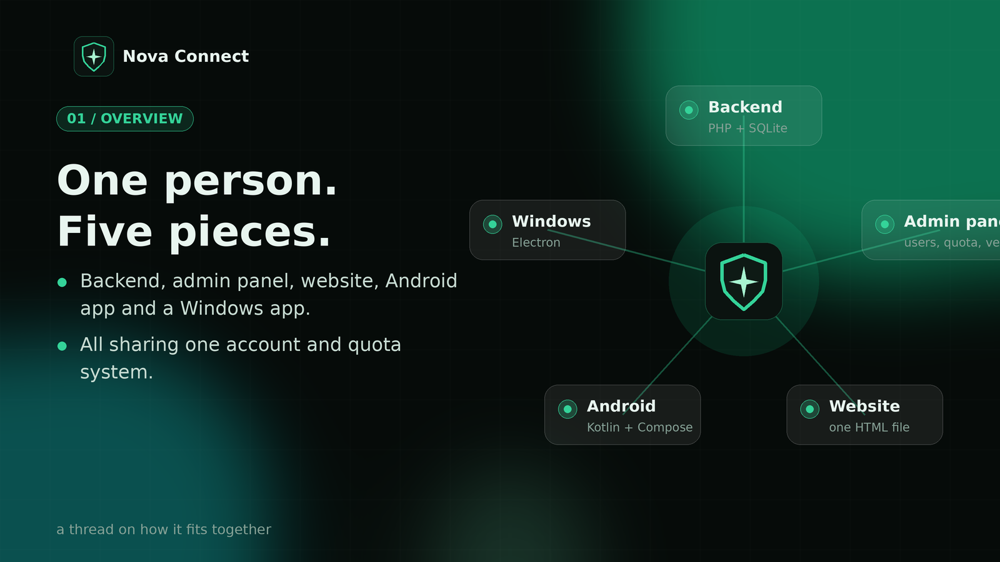
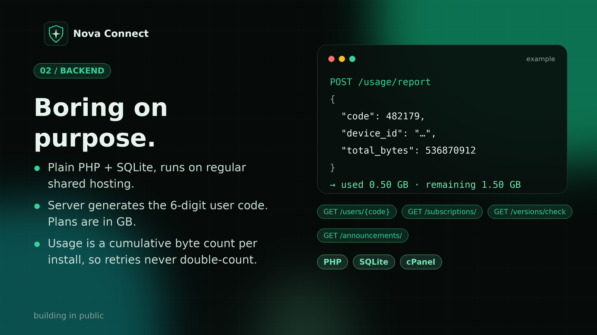
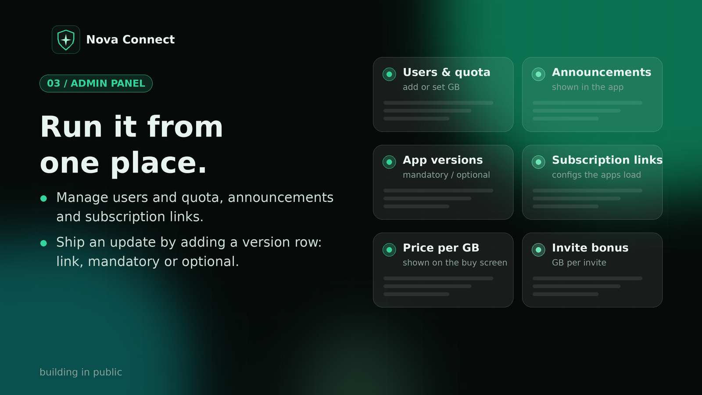
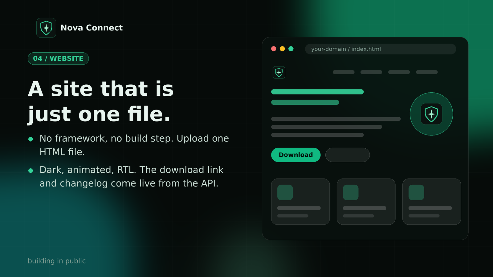
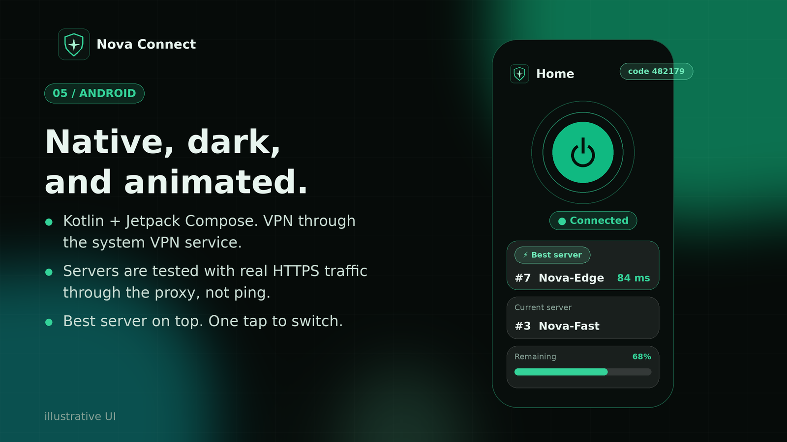
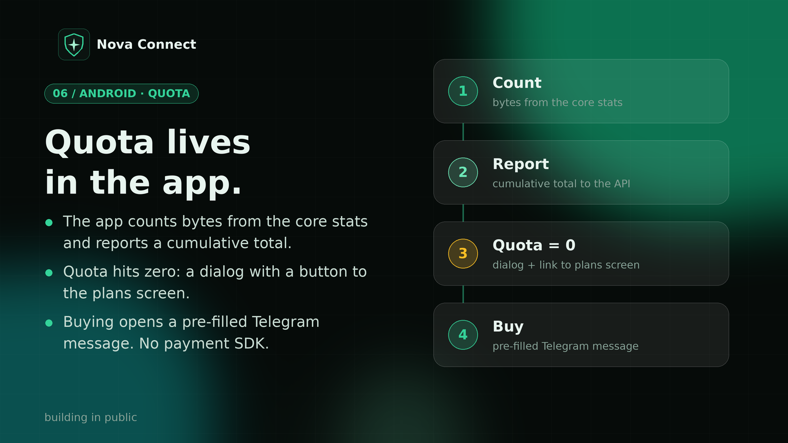
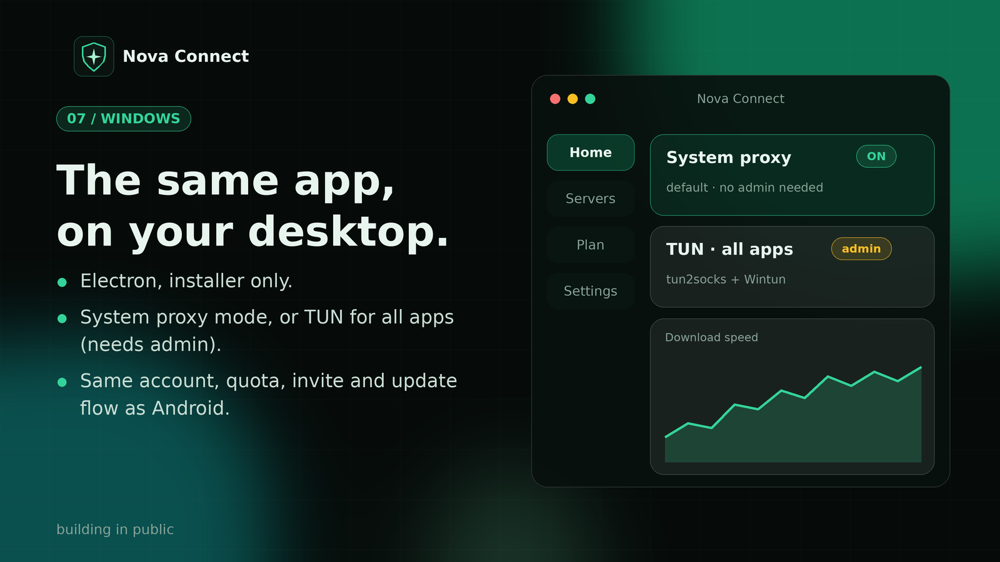
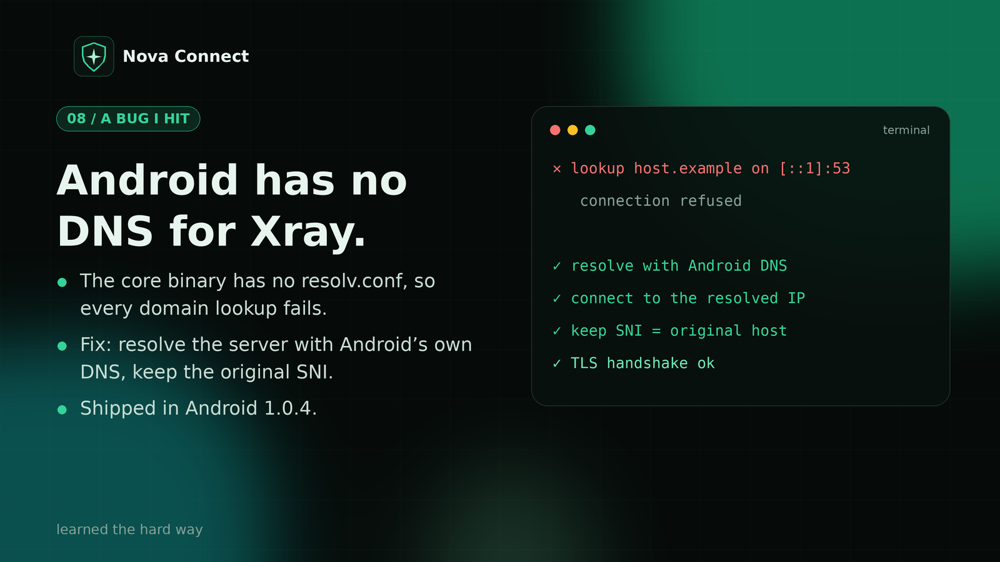
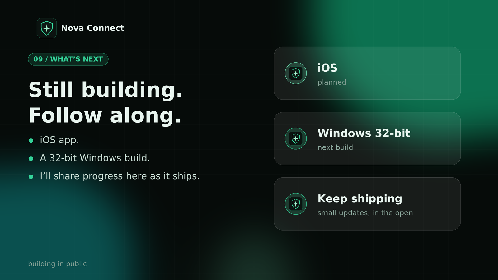

# Nova Connect

### One person. Five pieces. One engineering journey.

Nova Connect is a cross-platform networking project built around a shared backend, an admin panel, a website, an Android application, and a Windows desktop application.

The project is an opportunity to explore real-world software engineering challenges — from API design and quota tracking to native Android networking, desktop integration, and DNS troubleshooting.

**This is a learning-driven engineering project, not a configuration-reselling business.**

  

  <a href="#project-components">Components</a> ·
  <a href="#technical-highlights">Technical Highlights</a> ·
  <a href="#screenshots--posters">Posters</a> ·
  <a href="#downloads">Downloads</a> ·
  <a href="#roadmap">Roadmap</a>

---

## Table of Contents

- [Project Overview](#project-overview)
- [Project Components](#project-components)
- [Technical Highlights](#technical-highlights)
- [Screenshots & Posters](#screenshots--posters)
- [Downloads](#downloads)
- [Development Roadmap](#development-roadmap)
- [Project Purpose](#project-purpose)
- [Limitations & Transparency](#limitations--transparency)
- [Feedback & Contact](#feedback--contact)

---

## Project Overview

Nova Connect brings several parts of a software system together:

- A PHP and SQLite backend running on shared hosting.
- An administration panel for managing users, quotas, announcements, and application versions.
- A lightweight website built as a standalone HTML file.
- A native Android application built with Kotlin and Jetpack Compose.
- A Windows desktop application built with Electron.

The goal is to develop and maintain these components as parts of one connected system rather than treating them as isolated applications.

## Project Components

### 1. Backend API

**Technologies:** PHP, SQLite, HTTP APIs

The backend provides shared functionality for the applications and administration tools.

Current project features include:

- Six-digit user codes.
- Usage reporting based on transferred bytes.
- Cumulative usage tracking.
- Quota-related calculations.
- Integration with application and account management features.

The backend is designed to work on regular shared hosting, keeping infrastructure requirements relatively simple.

  

### 2. Administration Panel

The admin panel centralizes management tasks that would otherwise be spread across multiple interfaces.

Features include:

- User and quota management.
- Announcements.
- Application version management.
- Download and subscription links.
- Price-per-GB settings.
- Invitation bonuses.

The objective is to make system management easier while keeping the client applications connected to a common backend.

  

### 3. Website

**Technologies:** HTML, CSS, JavaScript, HTTP API

The website uses a standalone HTML file with a dark, animated interface.

Its intended responsibilities include:

- Introducing the project.
- Providing application download links.
- Displaying changelog information from the API.

The standalone approach avoids requiring a frontend framework or a separate build process for the website.

  

### 4. Android Application

**Technologies:** Kotlin, Jetpack Compose, Android VPN Service, Xray-core

Nova Connect for Android uses a native Android interface and the system VPN service for network integration.

Project features include:

- A dark, animated user interface.
- Current-server and recommended-server information.
- Server availability checks using HTTPS requests.
- Quota and usage screens.
- Communication with the shared backend.
- Integration with Xray-core and native networking components.

The goal is to keep the interface simple while handling networking complexity behind the scenes.

  

### 5. Quota & Usage Management

Usage tracking connects the client applications to the backend's quota system.

The current design includes:

- Byte-based usage reporting.
- Cumulative usage accounting.
- Quota information in the application.
- A purchase flow that opens a pre-filled Telegram message.

The Telegram flow is a messaging handoff; it does not itself process a payment.

  

### 6. Windows Application

**Technologies:** Electron, HTML, CSS, JavaScript, Node.js, Xray-core

Nova Connect for Windows brings the project to the desktop.

The application includes two networking modes:

- **System Proxy:** Uses the operating system's proxy settings.
- **TUN:** Provides a different routing approach for supported system traffic.

Other project features include server management, connection controls, and integration with the shared account and quota workflow.

The two modes have different networking requirements and are not interchangeable in every environment.

  

---

## Technical Highlights

Nova Connect is primarily about learning how separate software components interact.

### Backend and data

- Building APIs in PHP.
- Working with SQLite.
- Tracking usage in bytes.
- Maintaining cumulative usage values.
- Connecting client applications to shared backend services.

### Android and networking

- Developing a native Android UI with Kotlin and Jetpack Compose.
- Integrating Android's VPN service.
- Working with Xray-core and native networking libraries.
- Investigating DNS resolution and connectivity failures.

### Windows and desktop integration

- Building a desktop interface with Electron.
- Integrating networking components.
- Exploring System Proxy and TUN modes.
- Handling platform-specific networking constraints.

### Full-system development

- Connecting multiple clients to one backend.
- Managing application versions and download links.
- Keeping interfaces consistent across platforms.
- Debugging problems that cross application and networking boundaries.

## A Real Debugging Lesson: Android DNS

One of the project's networking challenges involved DNS resolution in the Android Xray integration.

The investigation identified a missing resolver configuration and a failed DNS request to a local resolver address. The fix described in the project's development notes was to resolve DNS through Android's resolver and pass the resulting IP address to Xray.

The change was included in Android version 1.0.4.

This is an example of the kind of problem that makes the project valuable to me: understanding why a system fails, tracing the failure across components, and working toward a practical fix.

  

---

## Screenshots & Posters

The following posters document the project's architecture, components, and development direction.

| Poster | Topic |
|---|---|
| 01 | Overall project architecture |
| 02 | Backend API |
| 03 | Administration panel |
| 04 | Website |
| 05 | Android application |
| 06 | Quota and usage management |
| 07 | Windows application |
| 08 | Android DNS debugging |
| 09 | Development roadmap |

All posters are stored in `assets/posters/` and displayed throughout this README.

---

## Downloads

Use the links below to access the available project builds.

- **Android:** [Download Android](https://github.com/Nova2585nd/Nova-connect-VPN-/releases/tag/Windows%26Android-versions)
- **Windows:** [Download Windows](https://github.com/Nova2585nd/Nova-connect-VPN-/releases/tag/Windows%26Android-versions)
- **Website:** [Visit the website](vpn.nova2585nd.ir)
- **All releases:** [GitHub Releases](https://github.com/Nova2585nd/Nova-connect-VPN-/releases/tag/Windows%26Android-versions)

Check the release notes for the version number, changes, and compatibility information before installing a build.

Only versions actually published should be considered available for download.

---

## Development Roadmap

The project is a work in progress. Planned areas of development include:

- [ ] Continued improvements to Android.
- [ ] Continued improvements to Windows.
- [ ] iOS support.
- [ ] Windows 32-bit compatibility.
- [ ] Improvements to reliability and networking diagnostics.
- [ ] Ongoing documentation and maintenance.

Roadmap items are development goals, not claims that the features are already implemented or guaranteed to ship.

  

---

## Project Purpose

Nova Connect is valuable to me because of the technical challenges involved and my interest in software engineering.

My motivation is to learn by building: connecting APIs, developing cross-platform applications, investigating networking issues, and understanding how a complete software system works.

**The primary purpose of this project is learning and engineering practice — not selling VPN configurations, monetizing access through configuration sales, or circumventing platform rules.**

I want the project to reflect the skills I develop, the problems I investigate, and the improvements I make over time.

---

## Limitations & Transparency

Nova Connect is an evolving project.

- Features may differ between Android and Windows.
- Compatibility depends on the operating system, device, and networking environment.
- A successful build does not guarantee that every server or network configuration will work.
- Roadmap items may change as development progresses.
- Download availability and version information should be checked against the actual published releases.

Please report reproducible issues with relevant application versions, operating system details, and sanitized logs. Do not share passwords, private keys, subscription URLs, or personal account codes in public issues.

## Feedback & Contact

- **GitHub repository:** [https://github.com/Nova2585nd/Nova-connect-VPN-]
- **Telegram:** [https://t.me/Nova_2585]
- **X:** [https://x.com/Nova_2585_nd/status/2115517742166028388?a=nV3zElfKU8DipkuKtso&s=20]
- **Website:** [https://nova2585nd.ir]
- **Downloads:** [https://github.com/Nova2585nd/Nova-connect-VPN-/releases]

Bug reports, technical feedback, and suggestions that help improve the project are welcome.

---

  <strong>Nova Connect</strong> 
  Building. Debugging. Learning. Improving.

